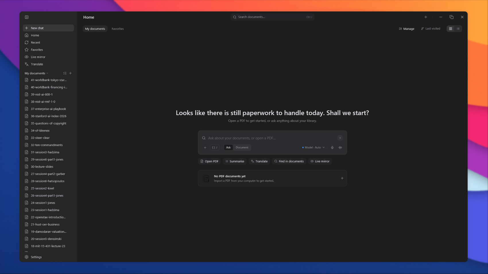
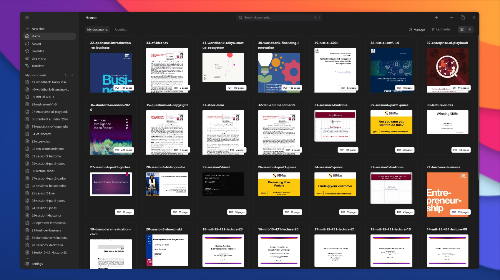

<p align="center">
  
</p>

<h1 align="center">Agentic Documents</h1>

<p align="center">
  A native reading and translation workspace for PDFs.<br>
  Ask a question, or open a document and read it side by side.
</p>

<p align="center">
  <a href="#what-it-is">What it is</a> ·
  <a href="#screens">Screens</a> ·
  <a href="#build">Build</a> ·
  <a href="#privacy">Privacy</a>
</p>

## What it is

- **Ask first.** A greeting composer takes a question about your library, or opens a PDF.
- **Your library, locally.** Imported PDFs and their first-page thumbnails live in one workspace.
- **Paired reading.** Source and translation sit in two panes with a draggable divider and synced scrolling; the original page furniture, charts and vector artwork stay untouched.
- **Providers you choose.** A local OpenAI-compatible loopback server, Google Cloud Translation, DeepL, or any OpenAI-compatible endpoint. Keys stay on the machine.
- **Live mirror.** Mirror a window or display, keep the capture local, and let OCR feed the same translation pipeline.
- **Light by design.** Native Rust + GPUI: no browser runtime, no Electron, no webview.

## Screens

<p align="center">
  
  
</p>

<p align="center"><sub>New chat — ask about your documents · Home — the local library</sub></p>

## Build

The desktop app is a Rust workspace in `native-shell`; the browser companion is a TypeScript extension in `extension`.

```powershell
# native app
cargo build --release --manifest-path native-shell/Cargo.toml -p pdf_workspace

# extension
pnpm install
pnpm build
```

`scripts/package-native.ps1` produces a portable Windows folder with `pdf_workspace.exe`, the native-messaging host, and the PDFium runtime beside it.

## Privacy

Everything stays on the machine by default: the library, thumbnails, captured frames and OCR text. Cloud translation is opt-in per provider and never runs without an explicitly allowed endpoint. No telemetry.
